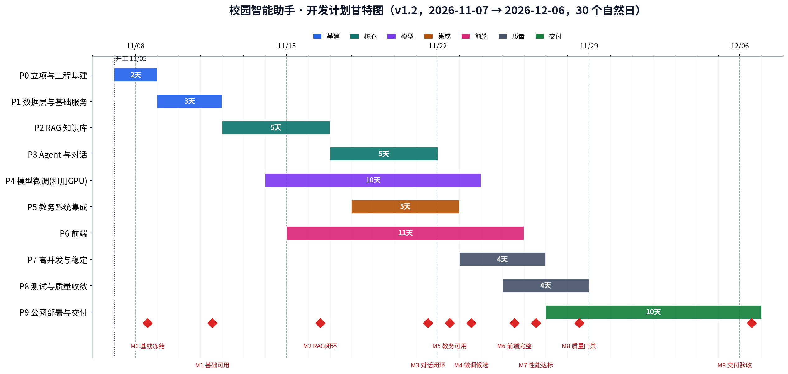
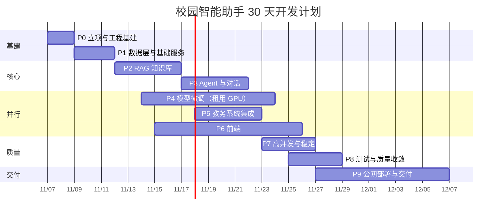

# 校园智能助手 —— 开发计划（v1.1）

| 项 | 内容 |
|---|---|
| 项目名称 | 校园智能助手（MVP：三级角色校园问答与教务服务） |
| 文档版本 | v1.2（2026-11-07，海外部署 / Windows 本地开发 / 模型上云） |
| 编制人 | 韩锦名（单人全栈开发） |
| 依据文档 | 《Python 程序设计作品选题申报》（汇报小组 12 组） |
| 总工期 | 30 个自然日（2026-11-07 至 2026-12-06），含 2 天缓冲 |
| 计划工时 | 106 人时（含质量动作）；AI 辅助下预计实际净人工工时 60–70 人时，另有训练/向量化/压测的挂机时间 8–12 小时 |
| 交付形态 | 公网可访问的线上服务（海外节点 + 域名 + HTTPS + 账号体系），非本地演示 |
| 计划性质 | 仅开发计划，不含任何代码实现动作 |

> v1.1 → v1.2 的修订：部署改为海外节点（免备案）；开发环境改为 Windows 原生、不装 WSL2；模型训练与推理上云、其余组件本地开发后整体上云；训练卡定为 4090；教务 SDK 与学校系统确认（school-sdk + 新版正方）；日期整体顺延 2 天至 12/06。

---

## 1. 项目目标与范围基线

### 1.1 问题与目标

选题源于校园信息服务分散的真实痛点：信息分布在官网、微信公众号、QQ 群、学生手册与各业务系统中，查找路径不清、通知过期后不可见、办理要求需自行梳理、跨部门事项缺少统一指引、提问口径不一且得不到及时准确答复、新生缺少 7×24 小时官方咨询入口。

作品以 **"能用、好用、可复现"** 为标准，不以功能数量取胜，主线任务完成质量是唯一衡量依据。最终形态是**公网可访问的线上系统**，不是本地跑通的演示程序——这一条决定了后面第 6 章 P9 阶段的全部内容。

### 1.2 功能范围（MVP 基线，共 6 条，不可增删）

| 编号 | 功能 | 能力边界（取自 PPT 思维导图） | 优先级 |
|---|---|---|---|
| F1 | 三级角色与权限隔离 | 访客（新生/家长）：7×24 招生政策、校园百科咨询；学生（在校生）：学号绑定、教务查询、个人问答；管理员（运维老师）：知识库增删改查、入库文件管理 | P0 |
| F2 | 校园事项问答并附依据来源 | 静态规章检索（bge 召回 + bge-reranker 重排 + ChromaDB）；动态全域搜索（AnySearch API 检索学校官网、通知公告）；防幻觉机制（回答附原文依据、官方链接） | P0 |
| F3 | 知识库管理与多格式解析 | 多格式解析（PaddleOCR + PDF/Word/表格结构化提取）；管理员上传文档、实时向量化入库；可视化列表展示入库文件状态与切片明细 | P0 |
| F4 | 教务系统同步与查询 | 登录助手自动认证正方教务系统；SDK 获取课表、成绩、学分计算 | P1 |
| F5 | 会话持久化与多轮追问 | 聊天记录 MySQL 持久化；LangGraph 状态机维护多轮上下文 | P0 |
| F6 | 高并发限制与稳定保障 | vLLM 调度 Qwen2.5-7B 微调模型；FastAPI 异步控制、请求队列防护、限流 | P1 |

### 1.3 明确不做（防止范围蔓延）

移动端原生 App、小程序、多租户/多校区、人工客服工单、支付缴费、消息推送（短信/邮件/微信模板）、数据大屏、多卡分布式训练、Kubernetes 编排、全文检索引擎（Elasticsearch 类）、缓存中间件（Redis 类）。以上一律不进本期。

### 1.4 已确认的环境前提

| 项 | 结论 | 对计划的影响 |
|---|---|---|
| 部署节点 | **海外（免 ICP 备案）**，只做域名解析 + TLS | P0-08 去掉备案分支；P9-02 简化为域名/DNS/证书 |
| 开发环境 | **Windows 11 原生，不装 WSL2** | 本地只装 Web 栈，零模型依赖；见 3.2 第 10 条 |
| 模型服务 | **所有模型都在云端**：Qwen2.5-7B（vLLM）、bge embedding、bge reranker、PaddleOCR，统一由自研 `model-service` 暴露 HTTP 接口；本地不含任何模型权重 | 本地零模型依赖，安装体量从数 GB 降到百 MB；开发期需云实例在线 |
| 最终部署 | 前端、后端、MySQL、Chroma、模型**全部上云** | P9 按整体搬迁设计，不做"半云半本地" |
| 训练卡 | **RTX 4090 24GB**，按小时租用，训练完释放 | P4 显存按 24GB 预算 |
| 教务系统 | 海南热带海洋学院，**新版正方**，`zfjw.hntou.edu.cn/jwglxt` | 用 `school-sdk`，host 直填该域名 |
| 服务器地域 | 海外机器访问国内教务系统延迟高，且有被风控风险 | 教务调用加超时/重试/缓存，见风险 R9 |

### 1.5 决策记录

| 编号 | 决策 | 日期 | 依据 |
|---|---|---|---|
| D-01 | 部署在海外节点，不做 ICP 备案 | 2026-11-07 | 备案 7–20 工作日不可控，课程交付等不起 |
| D-02 | Windows 本地开发，模型训练与推理在云端 | 2026-11-07 | 不装 WSL2；vLLM 仅支持 Linux，天然只能上云 |
| D-03 | 训练卡用 4090 24GB，用完即释放 | 2026-11-07 | 7B QLoRA 在 24GB 上够用，成本最低 |
| D-04 | 工期顺延 2 天至 12/06 | 2026-11-07 | P0 实际启动比计划晚 2 天 |
| D-05 | **所有模型上云**（大模型与功能模型），本地只做 HTTP 调用 | 2026-11-07 | 本地 Windows 不装模型运行时，避免 paddle/torch 双平台装不起来；模型算力集中在一处 |

---

## 2. 技术选型基线（冻结，不得变更）

| 层次 | 选型（与 PPT 完全一致） |
|---|---|
| 开发语言 | Python 3.10+ |
| 前端 | Vue 3 + Vite + Element Plus |
| 运行环境 | Ubuntu 22.04 LTS |
| 文件解析 | PaddleOCR + MarkItDown |
| 数据获取 | 开源的正方教务 SDK/API、AnySearch API |
| Web 后端与接口层 | FastAPI + Uvicorn + Pydantic |
| 关系数据库 | MySQL |
| 基座模型 | Qwen2.5-7B-Instruct |
| 训练 | Llama-Factory + QLoRA-SFT |
| 推理 | vLLM |
| 编排调度 | LangGraph |
| RAG | bge-large-zh-v1.5 + bge-reranker-v2-m3 + ChromaDB |

**锁定规则**：上述 12 项在项目周期内冻结；任何偏离须写 ADR 并在第 3.3 节登记，未登记即视为违规；版本号在第 2 天（P0-02）一次性锁定。

---

## 3. 技术栈核对（每一项在本项目里到底怎么用）

这一节是为了回答一个关键问题：这些组件各自负责什么、边界在哪、有哪些一定会踩到的坑。下面每一条都直接影响第 5 章的任务设计和第 11 章的风险判断。

### 3.1 逐项核对

| 组件 | 它实际是什么 | 在本项目里的具体用法 | 必须规避的坑 |
|---|---|---|---|
| Python 3.10+ | 运行时 | 后端、脚本、训练配置全部基于此 | PaddlePaddle 的官方 wheel 对 3.10 覆盖最完整，3.11/3.12 常缺轮子；开发机、训练机、生产机必须锁同一小版本，否则模型与向量结果可能不一致 |
| Ubuntu 22.04 LTS | 服务器操作系统，glibc 2.35，自带 Python 3.10 | 生产机与训练机都用它 | vLLM 只支持 Linux；训练机镜像若换了 CUDA 版本，torch/vLLM 版本要跟着对齐，否则 adapter 在生产机加载报错 |
| Vue 3 + Vite + Element Plus | 前端框架 / 构建工具 / 组件库 | 三角色界面、流式对话页、知识库管理页 | Vite 需要 Node 18+（建议 20 LTS）；Element Plus 按需引入要额外装两个构建插件——本项目**选择全量引入**，用体积换依赖数量，符合"不新增选型"的约束 |
| FastAPI + Uvicorn + Pydantic | 异步 Web 框架 / ASGI 服务器 / 数据校验 | 全部 HTTP 接口、SSE 流式输出、请求体校验、OpenAPI 文档 | Pydantic 必须统一 v2（`model_config`、`field_validator` 与 v1 不兼容）；**Uvicorn 只能起 1 个 worker**（见 3.2 第 1 条） |
| MySQL | 关系数据库 | 用户、会话、消息、引用、知识库文件元数据、配额、审计日志 | 没有向量检索能力，向量必须放 ChromaDB；建表统一 utf8mb4；引用信息用 JSON 列存，不做多表拆散 |
| LangGraph | 用图结构编排多步 Agent 的框架（节点 + 条件边 + 状态） | 意图识别 → 路由 → 工具调用 → 生成 → 引用装配 | 服务端要跑 async 节点；**不使用它的持久化 checkpointer**——会话历史自己存 MySQL，请求内重建状态。这样可以避开 `langgraph-checkpoint-mysql` 这类额外依赖，也避免状态与消息表不一致 |
| Qwen2.5-7B-Instruct | 7B 稠密指令模型，中英能力均衡，支持 32K 上下文 | 回答生成 + 查询改写 + 意图分类都用它 | fp16 权重约 15GB，实际部署把上下文限制在 4K–8K，否则 KV cache 吃满显存；不要拿它当 embedding 模型用 |
| Llama-Factory + QLoRA-SFT | 一站式微调框架 + 4bit 量化低秩微调 | 在租用 GPU 上产出 LoRA adapter（几十 MB） | QLoRA 训练 7B 在 24GB 卡上约需 12–16GB；训练完必须记录基座模型 revision，生产机加载时对不上会直接失败；数据里混入评测集会污染评估结论 |
| vLLM | 高吞吐推理引擎，PagedAttention + 连续批处理，提供 OpenAI 兼容接口 | 常驻云端生产机，`/v1/chat/completions` 供后端调用，`--enable-lora` 热挂载 adapter | 不要"先把 LoRA 合并进量化基座"——会掉精度且破坏量化标度；`gpu_memory_utilization` 设太高会把 embedding/rerank 挤爆显存；vLLM 启动慢，服务守护要容忍冷启动 |
| bge-large-zh-v1.5 | 中文 embedding 模型，326M 参数，1024 维，**最大输入 512 token** | **部署在云端 model-service**，本地通过 `/v1/embeddings` 调用；离线切片向量化与在线 query 向量化必须同模型同版本 | 512 token 上限是硬约束：切片必须按 token 计（建议 ≤480），按字数切很容易超限被静默截断；向量要归一化后做内积 |
| bge-reranker-v2-m3 | 交叉编码器重排模型，568M 参数，输入是（问题, 片段）对，输出相关性分数 | 对召回的 top20 逐对打分，取 top5 交给模型，同样受 512 token 限制 | 它比 embedding 慢一个量级（20 条约 100–300ms，GPU），并发时要限流；片段超过 512 token 会被截断，等于白排 |
| ChromaDB | 嵌入式向量数据库，本地持久化，支持 metadata 过滤 | 按知识域建 collection，存切片向量 + 元数据（部门、生效/失效日期、文件 ID、页码） | 单进程写入，多 worker 会锁冲突；collection 维度建好就固定（1024）；删除要按 `where` 条件批量删，不能只删文件记录 |
| PaddleOCR | OCR 引擎，依赖 paddlepaddle，输出带坐标的文本块 | **部署在云端 model-service**，本地解析流程对空文本文件发起 `/v1/ocr` 调用；只处理扫描件、图片型 PDF、截图版通知 | 安装体积大、依赖重，容易和其他库的 numpy/opencv 版本打架 → 独立 venv 验证后锁版本；输出只有文本块和坐标，**版面还原（多栏、表格）要自己按坐标排** |
| MarkItDown | 文档转 Markdown 工具，底层是 pdfminer / python-docx / openpyxl / python-pptx | 电子版 PDF、Word、Excel、PPT、HTML 的主力解析器 | **它没有 OCR**：扫描件会返回空内容且不报错，容易误判成功 → 必须做空文本检测；合并单元格、跨页表格会丢结构；PDF 多栏排版阅读顺序会乱 |
| 正方教务 SDK（`school-sdk`） | 社区维护的新版正方封裝（PyPI `school-sdk`，支持 3.8–3.13），提供 `user_login`/`get_schedule`/`get_score`/`get_info`/`check_session`/`proxy_request` | 登录认证、课表、成绩、学分；`host=zfjw.hntou.edu.cn`，`port=80`、`ssl=False`；若学校开图形验证码需装 `school-sdk[kaptcha]`（会拉 PyTorch 数百 MB），滑块则不需要 | 登录要 RSA 加密密码并带 csrftoken；**会话过期时接口仍返回 200，body 却是整页登录页**，必须检测响应特征而不是看状态码；部分接口缺 `gnmkdm` 参数会被踢下线；高峰期服务端本身不稳定 → 必须重试 + 退避 + 缓存 |
| AnySearch API | 面向 AI Agent 的搜索 API，`POST /v1/search`，返回结构化 JSON | 检索学校官网与通知公告，补静态知识库的时效性缺口 | 免费额度约 1000 次/天，Pro 最高 20 QPS；**官方没有域名白名单参数**，白名单只能做在结果侧（按 URL 域名过滤）；返回内容含 HTML 片段需清洗 |

### 3.2 由此产生的 12 条硬约束（直接决定架构与排期）

1. **Uvicorn 必须单 worker。** ChromaDB 是嵌入式单进程写入，限流计数在内存里，多 worker 会导致集合锁冲突和限流失效。并发能力靠 async + vLLM 批处理，不靠多进程。代价：不能靠加 worker 扩容，容量上限就是单机上限。
2. **切片按 token 计，不按字数。** bge 与 reranker 都是 512 token 上限，中文 1 字≈1 token。切片规格改为 300–480 token、重叠 60–80 token，否则超限部分被静默截断，召回质量莫名变差且难排查。
3. **解析必须做空文本分流。** MarkItDown 对扫描件静默返回空串，所以解析流水线要加一步：抽取文本 <50 字符即判失败，转 PaddleOCR 通道。这条写进 P2-01 的验收标准。
4. **不引入 Redis。** 限流用内存令牌桶，配额用 `api_quota` 表，缓存用 `search_cache` 表。选型里没有 Redis，硬加就是违规；单机部署下这套方案够用。
5. **显存要排预算。** 单卡 24GB 装 7B 推理 + embedding + rerank：权重 15.2GB + KV cache（4K 上下文、并发 8）约 3.5GB + bge 0.65GB + reranker 1.1GB + CUDA 上下文约 0.5GB ≈ 21GB，`gpu_memory_utilization` 只能给到 0.85，`max_model_len` 限制 4096。想要更高并发必须换 40GB 卡，这是硬成本。
6. **LoRA 不合并。** 生产用 vLLM `--enable-lora` 热挂载 adapter，基座与 adapter 版本成对记录在 `model_version` 表，回退时只切 adapter 路径。
7. **外网搜索有每日配额。** 1000 次/天是免费档上限，必须做查询缓存 + 每用户每日配额 + 失败降级，否则被刷爆就整条链路失效。
8. **HTTPS 由 Uvicorn 直接终止。** 用 `--ssl-keyfile/--ssl-certfile` 起服务，不引入 Nginx（选型里没有）。若之后改用云厂商负载均衡，属于新增基础设施，要在 3.3 登记。
9. **海外节点不等于零成本。** 免备案但延迟高（国内用户 150–300ms），且教务系统在境内，服务器在境外访问会慢、还可能被风控判为异地登录。教务调用必须设 10s 超时、2 次重试、结果缓存。
10. **本地零模型依赖。** Windows 上只装 Web 栈（FastAPI、MySQL 驱动、httpx、chromadb 客户端、markitdown），不装 torch / paddle / vllm。模型相关的重依赖只出现在云端 `model-service` 的依赖文件里，双平台漂移问题从"每个包都可能不一致"缩到"两台 Linux 之间对齐"。
11. **模型调用统一走三个客户端。** `LLMClient`（vLLM `/v1/chat/completions`）、`EmbeddingClient`（`/v1/embeddings`）、`RerankerClient`（`/v1/rerank`），加上 OCR 的 `/v1/ocr`。业务层只依赖接口，不感知模型在哪；换卡、换机器、换量化版本都只改配置。
12. **云端是单点。** 所有模型都在云上，实例一关，问答、检索、上传全部不可用。所以：模型服务要有 `/healthz`，后端启动时探测并明确报错；开发期按需开机；预算与开机时段写进 P0-07。

### 3.3 依赖登记（除 12 项选型外，仅登记这些）

| 依赖 | 用途 | 进入运行栈 | 理由 |
|---|---|---|---|
| aiomysql | MySQL 异步驱动 | 是 | FastAPI 全异步链路需要异步驱动 |
| PyJWT | JWT 签发与校验 | 是 | 鉴权必需 |
| bcrypt | 口令哈希 | 是 | 不存明文口令 |
| python-multipart | 表单/文件上传解析 | 是 | FastAPI 上传接口必需 |
| httpx | 调用 AnySearch、vLLM、教务接口 | 是 | 支持异步与超时控制 |
| FlagEmbedding | 加载 bge embedding 与 reranker | **仅云端 model-service** | 两个模型的官方推理封装，不进本地环境 |
| markitdown | 文档转 Markdown（纯解析，不是模型） | 是（本地） | 选型内组件 |
| paddlepaddle + paddleocr | OCR | **仅云端 model-service** | 选型内组件，独立 venv 安装 |
| chromadb | 向量库客户端 | 是 | 选型内组件 |
| pytest + pytest-asyncio + pytest-cov | 测试 | 否（开发期） | 质量门禁需要，不进生产镜像 |
| Pinia + axios | 前端状态与请求 | 是（Vue 生态配套） | Vue 3 官方推荐组合；若坚持零新增，可用内置 reactive + fetch 替代 |

除此之外不加任何框架、中间件、数据库或云服务。新增一项就要在变更记录里写清楚为什么。

---

## 4. 工程规范

**仓库结构**：monorepo，`backend/`（FastAPI 服务）、`frontend/`（Vue 3）、`docs/`、`scripts/`。后端分层固定为 `api/v1` → `services` → `repositories` → `domain`，`agents/`、`rag/`、`integrations/` 三个横向模块独立，禁止跨层直接调数据库。

**分支与提交**：`main` 受保护；功能分支 `feat/T{任务ID}-{简述}`；提交遵循 Conventional Commits 并关联任务 ID；里程碑打 tag（`v0.1.0` → `v1.0.0`）。

**接口规范**：统一前缀 `/api/v1`，统一响应 `{code, message, data, trace_id}`，错误码集中定义（`AUTH_401`、`RAG_NO_EVIDENCE`、`EDU_SESSION_EXPIRED`、`SEARCH_QUOTA_EXCEEDED`、`RATE_LIMITED_429` 等）；OpenAPI 自动生成，合并前核对契约。

**配置与数据**：全环境变量 + Pydantic 启动期校验，缺配置直接启动失败；密钥不入库；结构变更走版本化 SQL 迁移（`migrations/000X_*.sql` + `schema_version` 表），禁止手工改生产表。

**日志与观测**：结构化 JSON + 全链路 `trace_id`；口令、学号、成绩、教务凭据在日志层统一脱敏；`/healthz` 与 `/readyz` 双探针（readyz 检查 MySQL、ChromaDB、vLLM 三项）。

**安全基线**：JWT + 三角色 RBAC，越权校验在服务层二次执行；教务凭据加密存储，密钥独立于代码；提示词注入防护（检索内容与用户输入分区、结果侧域名过滤、系统提示不可覆盖）；上传文件做类型/大小/内容三重校验。

**单人自审**：每个任务完成即过 DoD 六项——接口可用、单测通过、日志可定位、异常有兜底、文档同步、提交合规。每日日终写 5 行开发日志。

---

## 5. 总工期与阶段划分

### 5.1 阶段总览

| 阶段 | 名称 | 起止 | 天数 | 主要目标 | 里程碑 |
|---|---|---|---|---|---|
| P0 | 立项与工程基建 | 11/07 – 11/08 | 2 | 需求冻结、选型锁定、环境就绪、**云资源与域名启动** | M0 基线冻结 |
| P1 | 数据层与基础服务 | 11/09 – 11/11 | 3 | 库表、鉴权、三角色骨架、统一基础设施 | M1 基础可用 |
| P2 | RAG 知识库子系统 | 11/12 – 11/16 | 5 | 解析 → 切片 → 入库 → 检索重排 → 溯源闭环 | M2 RAG 闭环 |
| P3 | Agent 编排与对话 | 11/17 – 11/21 | 5 | LangGraph 状态机、工具节点、流式输出、多轮 | M3 对话闭环 |
| P4 | 模型微调（租用 GPU） | 11/14 – 11/23 | 10 | 数据、训练机环境、QLoRA 训练、adapter 热挂载、对比评测 | M4 微调候选 |
| P5 | 教务系统集成 | 11/18 – 11/22 | 5 | SDK 连通、会话复用、课表成绩学分、缓存重试 | M5 教务可用 |
| P6 | 前端 | 11/15 – 11/25 | 11 | 三角色界面、流式对话、知识库管理、教务页 | M6 前端完整 |
| P7 | 高并发与稳定性 | 11/23 – 11/26 | 4 | 异步化、限流队列、vLLM 调优与显存预算、压测、降级 | M7 性能达标 |
| P8 | 测试与质量收敛 | 11/25 – 11/28 | 4 | 单测/集成/E2E/安全/公网暴露面/RAG 终评 | M8 质量门禁 |
| P9 | 公网部署与交付 | 11/27 – 12/06 | 10 | 服务器初始化、TLS、备份、发布回滚、监控、演示、文档 | M9 验收交付 |

### 5.2 甘特图

图片版见同目录 `开发计划_甘特图_v1.2.png`（直接可看，不依赖任何渲染器）。可编辑的 Mermaid 源码放在附录 C——**如果你的 Markdown 预览器不支持 Mermaid，看到的会是一段代码而不是图**，这是渲染器的问题，不是文件坏了。

### 5.3 四条并行工作流

A 线（主线）P1 → P2 → P3 → P7，任何延迟优先保 A 线；B 线（模型）P4，训练时挂机、训练完回 A 线；C 线（前端）P6，靠 P1 冻结的 OpenAPI 契约与 mock 解耦；D 线（集成与交付）P5 → P9，外部依赖最多，连通性验证提前到第 2 天。

---

## 6. 详细任务分解

> 预估为 AI 辅助下的净人工工时，不含训练、向量化、压测的挂机时间。

### P0 立项与工程基建（11/07 – 11/08）｜10 人时

| ID | 任务 | 关键动作 | 产出物 | 验收标准 | 预估 | 依赖 |
|---|---|---|---|---|---|---|
| P0-01 | 需求基线冻结 | 6 条 MVP 拆用例（≥18 条），每条写清判定口径；三角色权限矩阵 | 需求基线、用例清单、权限矩阵 | 每条用例都可判定通过/不通过；权限矩阵覆盖全部接口 | 1.5h | — |
| P0-02 | 选型锁定与版本矩阵 | 锁 Python 小版本、模型 revision 与各框架版本；按部署单元出**三份依赖**：本地后端（Win）、云端后端（Linux）、云端模型服务（Linux GPU）；生成 `.nvmrc` | 版本矩阵 + 三份 requirements | 本地依赖不含任何模型运行时；模型服务依赖可独立安装 | 1.5h | — |
| P0-03 | 仓库与工程结构 | monorepo、分支保护、提交模板、README | 仓库骨架 | clone 后按 README 三步起空服务 | 1h | — |
| P0-04 | 三套环境准备 | 开发机（Ubuntu 22.04/WSL2）、训练机、生产服务器的账号与登录方式；MySQL、Node、GPU 驱动 | 环境检查脚本 | 本机检查全绿；SSH 到两台服务器均可用 | 2h | P0-02 |
| P0-05 | 配置与密钥管理 | Pydantic 配置模型、`.env.example`、密钥分级 | 配置模块 | 缺必填启动即失败；仓库内搜不到真实密钥 | 1h | P0-03 |
| P0-06 | 文档骨架 | 架构、接口、库表、部署、测试五份模板 | `docs/` 五份 | 章节与各阶段产出物对齐 | 1h | — |
| P0-07 | 云资源选型与预算 | 训练机：24GB 卡按小时租，训练 6–10 小时即释放；生产机：需常驻 GPU（vLLM），按周或按月，磁盘 ≥100GB（模型 15GB + 环境 + 文档 + 向量），带宽 ≥5Mbps；列出 2–3 家报价 | 资源清单与预算上限 | 训练成本 <100 元；生产成本有明确上限与关停条件 | 1.5h | — |
| P0-08 | 域名、DNS 与 TLS | 定海外节点（已定 D-01）；购买域名并解析到服务器；申请免费证书（DNS-01 验证，需你操作）；确定对外端口与安全组规则 | 域名与证书清单 | 域名可解析、证书可签发，Uvicorn 能直接加载 | 1h | — |

### P1 数据层与基础服务（11/09 – 11/11）｜9 人时

| ID | 任务 | 关键动作 | 产出物 | 验收标准 | 预估 | 依赖 |
|---|---|---|---|---|---|---|
| P1-01 | 数据模型设计 | 13 张表：`user_account`、`student_profile`、`conversation`、`message`、`citation`、`kb_file`、`kb_chunk`、`parse_task`、`search_cache`、`api_quota`、`audit_log`、`model_version`、`schema_version` | ERD + `0001_init.sql` | 表有主键、外键、索引、注释；会话列表与文件列表有覆盖索引 | 1.5h | P0-01 |
| P1-02 | 迁移与种子 | 版本化迁移执行器、脱敏演示数据、清库重建 | 迁移与种子脚本 | 空库一条命令建全；重复执行幂等 | 1h | P1-01 |
| P1-03 | 数据访问层 | aiomysql 连接池、事务封装、repository 分层 | `repositories/*` | 业务层无裸 SQL；连接不泄漏；异常可回滚 | 1.5h | P1-02 |
| P1-04 | 统一基础设施 | trace_id 中间件、结构化日志、全局异常、统一响应 | `core/` 四模块 | 任一异常可凭 trace_id 串起完整链路 | 1h | P0-05 |
| P1-05 | 鉴权与 RBAC | JWT 签发/刷新/注销、三角色依赖注入、服务层越权二次校验、登录失败锁定 | `/auth/*`、`/me` | 三角色交叉调用越权接口 100% 403；过期返回 401 可刷新 | 2h | P1-04 |
| P1-06 | 会话与用户接口 | 会话增删改查、消息落库、分页搜索 | `/conversations` 系列 | 建会话→发消息→查历史可用；分页与归属校验正确 | 1h | P1-05 |
| P1-07 | 测试基线 | 测试目录、测试库隔离、公共 fixture、覆盖率口径 | `tests/` + 基线报告 | `pytest` 一键跑通 | 1h | P1-03 |

### P2 RAG 知识库子系统（11/12 – 11/16）｜12 人时

| ID | 任务 | 关键动作 | 产出物 | 验收标准 | 预估 | 依赖 |
|---|---|---|---|---|---|---|
| P2-01 | 解析流水线（双通道） | MarkItDown 走电子文档；**空文本检测（<50 字符判失败）转 PaddleOCR**；PaddleOCR 输出按坐标做版面重排 | 解析模块 | 20 份样本（含 5 份扫描件、2 份表格）成功率 ≥95%；扫描件必须被判为 OCR 通道而不是"解析成功但内容为空" | 2h | P1-02 |
| P2-02 | 切片策略（按 token） | 标题层级感知 + **300–480 token** 切片、重叠 60–80 token、表格转结构化文本、元数据抽取（部门、生效/失效日、原文 URL、页码、版本） | 切片器 + 策略说明 | 切片不超 480 token（用 bge tokenizer 实测）；不切断表格；每片元数据完整；重复解析结果一致 | 1.5h | P2-01 |
| P2-03 | 向量化与入库 | bge-large-zh-v1.5（1024 维）批量向量化、归一化、collection 设计、幂等 upsert、按文件删除 | 向量化模块 | 1024 维与 collection 配置一致；重复入库不产生重复向量；删除文件后检索不再命中 | 1.5h | P2-02 |
| P2-04 | 检索与重排 | 召回 top20 → reranker 打分取 top5 → 阈值过滤 → 组装引用（文件 + 页码 + 片段 + 链接） | 检索服务 + `/rag/search` | 评测集 Recall@5 ≥85%；每条结果可回溯到文件与页码；重排耗时 <400ms | 2h | P2-03 |
| P2-05 | 知识库管理接口 | 上传校验、解析任务状态机、切片明细分页、删除与重建 | `/kb/*` 六接口 | 上传→解析中→成功/失败可查；失败有原因；切片明细含原文与向量 ID | 2h | P2-04 |
| P2-06 | RAG 评测集 | 60 条问答对（问题、标准答案、依据文件、页码），覆盖招生/教务/后勤/奖惩/时效通知；跑分脚本 | 评测集 + 评测报告 1 | 指标齐备（Recall@5、引用准确率、无答案识别率）；结果可复现 | 2h | P2-04 |
| P2-07 | 时效性治理 | `effective_to` 过滤、过期标记、降权与提示 | 时效策略 | 过期通知不作主依据；命中过期内容明确提示以最新为准 | 1h | P2-05 |

### P3 Agent 编排与对话（11/17 – 11/21）｜12.5 人时

| ID | 任务 | 关键动作 | 产出物 | 验收标准 | 预估 | 依赖 |
|---|---|---|---|---|---|---|
| P3-01 | LangGraph 状态机 | 意图识别 → 路由（静态检索/动态搜索/教务/闲聊/兜底）→ 工具 → 生成 → 引用装配；状态用 Pydantic 定义，**不用 checkpointer** | 状态机图 + `agents/graph.py` | 五类意图各 5 条，路由准确率 ≥90%；异常节点回退兜底不崩 | 2h | P1-06、P2-04 |
| P3-02 | 提示词体系 | 系统提示（禁编造、必给依据）、三角色差异化、拒答与兜底话术 | 版本化提示词 | 提示词有版本号；同一问题在三角色下边界符合权限矩阵 | 1.5h | P3-01 |
| P3-03 | 静态检索节点 | 封装 P2 检索为工具，输出结构化证据块 | 工具节点 | 证据字段完整；无命中返回明确信号而非空串 | 1h | P2-04 |
| P3-04 | 动态搜索节点 | AnySearch `POST /v1/search`（zone=cn，max_results≤10）、查询改写、**结果侧域名过滤**、HTML 清洗、超时降级、查询缓存 | 工具节点 + 缓存 | 三类典型问题命中官网 ≥80%；超时 5s 内降级；同一问题 24h 内不重复调用配额 | 2h | P3-03 |
| P3-05 | 教务工具节点 | 封装 P5 服务（课表/成绩/学分），仅学生角色可调 | 工具节点 | 越权被拒；上游失败降级为"暂不可用 + 跳转指引" | 1h | P5-03 |
| P3-06 | 流式对话接口 | SSE（首 token/增量/引用/结束事件）、中断清理、超时重试 | `POST /conversations/{id}/messages` | 首 token ≤3s（10 并发下）；断线后消息仍完整落库 | 1.5h | P3-02 |
| P3-07 | 多轮上下文 | 会话摘要、指代消解、token 预算与裁剪 | 上下文模块 | 连续 5 轮追问连贯；超长会话不超 4K 上限且关键信息不丢 | 1.5h | P3-06 |
| P3-08 | vLLM 客户端 | OpenAI 兼容调用、超时、重试、模型不可用降级 | `integrations/llm_client.py` | 模型重启期间不 500，按降级话术返回 | 1h | P0-04 |
| P3-09 | Agent 轨迹日志 | 记录节点路径、工具调用、证据、耗时、token | 轨迹日志 | 任取一条会话可完整复盘决策路径 | 1h | P3-06 |

### P4 模型微调（11/14 – 11/23，租用 GPU）｜9.5 人时 + 挂机 6–10 小时

| ID | 任务 | 关键动作 | 产出物 | 验收标准 | 预估 | 依赖 |
|---|---|---|---|---|---|---|
| P4-01 | SFT 数据构造 | 500–1000 条指令数据，覆盖三角色口吻、引用规范、拒答样本；统一为 Llama-Factory 格式 | `data/sft/train.json` | 三角色占比均衡 ±10%；拒答样本 ≥10%；零真实隐私数据 | 2h | P0-01 |
| P4-02 | 数据质量审核 | 去重、长度分布、抽检、格式校验、**评测集隔离检查** | 数据质量报告 | 抽检 50 条无事实错误；训练集与评测集零重叠 | 1h | P4-01 |
| P4-03 | 训练机环境对齐 | 开通实例即决定镜像：CUDA / torch / transformers / peft / Llama-Factory 版本与生产机 vLLM 对齐；上传数据（脱敏）、断点续传 | 环境记录 + 上传脚本 | 训练机能加载基座；版本表与 P0-02 一致 | 1h | P0-07 |
| P4-04 | 训练配置 | QLoRA 4bit（NF4）、LoRA rank/alpha、学习率、epoch、seq 2048、梯度累积；显存预算 12–16GB | `train_config.yaml` | 峰值显存 <24GB×0.9；1 个 epoch 不 OOM | 1h | P4-03 |
| P4-05 | 训练执行 | 提交训练、观察 loss、保存 checkpoint、中断续跑 | 训练日志 + adapter | 可中断续跑；每轮可追溯（配置+数据版本+指标） | 1h（挂机 4–8h） | P4-04 |
| P4-06 | adapter 导出与热挂载 | 导出 LoRA（不合并权重），vLLM `--enable-lora --lora-modules` 挂载，`model_version` 表登记基座 revision | adapter + 启动参数 | 基座与 adapter 并存可切换；加载失败可回退基座 | 1.5h | P4-05 |
| P4-07 | 对比评测与灰度 | 基座 vs 微调在 60 条评测集上对比；切换开关；3 分钟内回退 | 对比报告 + 切换脚本 | 引用准确率与拒答率不低于基座，否则不上线 | 1.5h | P4-06、P2-06 |
| P4-08 | 数据与成本收口 | 训练数据上传后本地留存策略、实例释放、账单核对 | 成本记录 | 训练结束 30 分钟内释放实例；成本不超预算 | 0.5h | P4-05 |

### P5 教务系统集成（11/18 – 11/22）｜7 人时

| ID | 任务 | 关键动作 | 产出物 | 验收标准 | 预估 | 依赖 |
|---|---|---|---|---|---|---|
| P5-01 | SDK 连通性验证（第 2 天） | 确认学校教务系统版本（新/旧正方）、登录方式、验证码形态、SDK 是否可用 | 连通性报告 | 明确结论：可用/部分可用/不可用；不可用即触发 R2 预案 | 1h | P0-04 |
| P5-02 | 登录与会话复用 | RSA 加密密码 + csrftoken；登录后跟随 302 取 JSESSIONID；会话落库复用；**检测"200 + 登录页"的失效特征并自动重登** | 登录模块 | 会话失效后自动恢复且只重试一次；日志无明文凭据 | 1.5h | P1-05、P5-01 |
| P5-03 | 信息查询 | 课表（周次/节次/地点）、成绩（学期/绩点）、学分计算规则 | `/edu/*` 三接口 | 抽样 10 条与教务原始数据一致；学分规则人工验证 | 2h | P5-02 |
| P5-04 | 缓存与重试 | 结果 TTL 缓存、单用户 ≤1 次/分钟、指数退避重试、超时熔断 | 缓存与重试模块 | 重复查询命中缓存；上游抖动不拖垮服务 | 1h | P5-03 |
| P5-05 | 合规与最小权限 | 仅本人数据、越权探测、留存期限、隐私说明 | 合规说明 + 越权用例 | A 学号令牌查 B 学号必须失败 | 1h | P5-03 |
| P5-06 | SDK 隔离适配层 | 把 SDK 调用收在 `integrations/edu/` 一个适配层内，SDK 升级或换版本只改这一处 | 适配层 | 业务层不 import SDK；替换实现不改业务代码 | 0.5h | P5-03 |

### P6 前端（11/15 – 11/25）｜14 人时

| ID | 任务 | 关键动作 | 产出物 | 验收标准 | 预估 | 依赖 |
|---|---|---|---|---|---|---|
| P6-01 | 工程初始化 | Vue3 + Vite + Element Plus（**全量引入**）、环境变量、请求层（拦截器、401 刷新、统一错误）、OpenAPI 类型对齐 | 前端骨架 + `api/` | 两套环境配置生效；类型与后端契约一致 | 1.5h | P0-02、P1-04 |
| P6-02 | 权限路由与三角色框架 | 路由守卫、动态菜单、角色切换、403/404 | 路由与布局 | 越权路由被拦截；菜单与后端权限一致 | 1.5h | P6-01、P1-05 |
| P6-03 | 对话页（核心） | SSE 流式渲染、Markdown/表格渲染、引用卡片（文件+页码+片段+链接）、追问、停止生成、重试 | 对话页 | 首 token ≤3s 可见；引用可定位原文；中断可重试 | 3h | P6-02、P3-06 |
| P6-04 | 知识库管理页 | 拖拽上传、解析进度轮询、文件列表（状态/大小/切片数）、切片明细抽屉、删除与重建 | 管理页 | 上传后状态实时变化；切片明细可流畅翻页 | 2.5h | P6-02、P2-05 |
| P6-05 | 教务页 | 课表网格、成绩表格与学期筛选、学分卡片、绑定/解绑 | 教务页 | 与教务原始数据一致；未绑定有引导 | 2h | P6-02、P5-03 |
| P6-06 | 历史与个人中心 | 历史会话列表、搜索、重命名、删除、解绑 | 历史页 | 删除会话同步删消息与引用 | 1h | P6-03 |
| P6-07 | 体验与适配 | 加载/空/错误态、骨架屏、375/768/1440 三档、对比度与焦点 | 优化清单 | 三档宽度无横向滚动与错位 | 1.5h | P6-04、P6-05 |
| P6-08 | 联调收口 | 真实后端联调、移除 mock、构建体积检查 | 生产构建包 | 无 mock 残留；首屏 ≤1.5MB（gzip） | 1h | P6-07 |

### P7 高并发与稳定性（11/23 – 11/26）｜8.5 人时

| ID | 任务 | 关键动作 | 产出物 | 验收标准 | 预估 | 依赖 |
|---|---|---|---|---|---|---|
| P7-01 | 服务异步化 | 全链路 async、chromadb 与 OCR 等同步调用下放线程池、连接池与 httpx 复用 | 优化记录 | 无事件循环阻塞告警；空闲内存稳定 | 1h | P3-06 |
| P7-02 | 限流与排队 | 内存令牌桶（用户 + IP 双维度）、排队队列与最大等待、429 语义、超限落库 | 限流中间件 | 超限 100% 429 且提示明确；正常用户不误伤 | 1.5h | P7-01 |
| P7-03 | 显存与推理调优 | `gpu_memory_utilization`、`max_model_len`、KV cache、batch 参数；embedding/rerank 与生成错峰；必要时给 bge 留固定显存 | 调优参数表 + 显存实测 | 24GB 卡上 10 并发 P95 首 token ≤3s；显存占用 ≤21GB | 2h | P4-07 |
| P7-04 | 压测 | 阶梯 5/10/20/30/50 并发；错误率、延迟分位、排队长度、显存曲线 | 性能报告 | 30 并发错误率 <1%、P95 首 token ≤5s；50 并发进入排队而非崩溃 | 2h | P7-02、P7-03 |
| P7-05 | 可观测性 | 探针、关键日志（QPS、延迟、限流次数、检索命中率、搜索配额余量）、慢请求排行 | 指标清单 | 故障 5 分钟内能定位环节 | 1h | P7-04 |
| P7-06 | 故障演练 | 模型宕机、ChromaDB 不可用、MySQL 断连、AnySearch 超时、磁盘满、显存 OOM 六种场景 | 演练报告 + 降级表 | 六种场景均无白屏；均有可读提示与恢复路径 | 1h | P7-05 |

### P8 测试与质量收敛（11/25 – 11/28）｜10.5 人时

| ID | 任务 | 关键动作 | 产出物 | 验收标准 | 预估 | 依赖 |
|---|---|---|---|---|---|---|
| P8-01 | 单元测试 | 切片、检索重排、权限、限流、学分计算、上下文裁剪 | 单测套件 | 核心模块覆盖率 ≥70%，关键分支 ≥80% | 2h | P7-06 |
| P8-02 | 接口集成测试 | 按契约逐接口，含 401/403/422/429/5xx 与幂等 | 集成套件 | 每接口 ≥1 正例 2 反例，全通过 | 1.5h | P8-01 |
| P8-03 | E2E 主路径 | 访客问答（含拒答）、学生教务查询、管理员上传→检索生效 | E2E 脚本 + 录屏 | 三条路径端到端跑通，可重复执行 | 1.5h | P6-08 |
| P8-04 | RAG 终评 | 60 条评测集复测，基座 vs 微调 | 评测报告 2 | 引用准确率 ≥90%；无答案识别 ≥85%；编造依据 <5% | 1.5h | P4-07 |
| P8-05 | 安全测试 | 越权、SQL 注入、XSS、上传绕过、提示词注入、敏感信息泄露、弱口令 | 安全报告 | 高危 0；中危有处置结论 | 1.5h | P8-02 |
| P8-06 | 公网暴露面检查 | 端口扫描（仅 22/443 开放）、默认口令、错误页信息泄露、API Key 是否进前端、CORS、限流有效性 | 暴露面清单 | 无多余端口；前端产物中无任何密钥；错误页不透出堆栈 | 1h | P9-01 |
| P8-07 | 缺陷收敛 | 分级（P0/P1/P2/P3）与修复验证 | 缺陷清单 | P0/P1 清零；P2 有结论 | 1.5h | P8-03、P8-05 |

### P9 公网部署与交付（11/27 – 12/06）｜13 人时

| ID | 任务 | 关键动作 | 产出物 | 验收标准 | 预估 | 依赖 |
|---|---|---|---|---|---|---|
| P9-01 | 服务器初始化 | 系统依赖、服务用户、目录权限、venv、后端与前端构建产物、vLLM 常驻（systemd 托管、开机自启、崩溃重启、冷启动等待） | 初始化脚本 | 空服务器两条脚本后服务可用；重启机器自动拉起 | 2h | P0-07 |
| P9-02 | TLS 与对外访问 | Uvicorn 加载证书直接终止 TLS；域名解析；海外节点免备案，无备案依赖；安全组只开 22/443 | 可访问地址 | 浏览器 https 访问无证书告警；http 自动跳转 | 1.5h | P0-08、P9-01 |
| P9-03 | 备份与恢复 | MySQL 每日备份、ChromaDB 快照、模型与 adapter 备份、恢复演练 | 备份脚本 + 恢复手册 | 从备份完整恢复一次，数据零丢失；记录耗时 | 1.5h | P9-01 |
| P9-04 | 发布与回滚 | 版本 tag、发布检查单、回滚步骤、迁移回滚策略 | 发布手册 | 模拟发布 + 回滚各一次，均 <10 分钟 | 1h | P9-03 |
| P9-05 | 演示准备 | 脱敏演示数据、三角色各 3 分钟脚本、预置典型问题、断网兜底（静态知识库） | 演示脚本 + 数据包 | 断网仍可演示访客问答；三段各跑 3 遍无失败 | 1.5h | P9-02 |
| P9-06 | 监控与运维 | 日志轮转、磁盘水位、显存水位、进程存活、配额余量告警（日志级即可）、每日巡检清单 | 巡检清单 | 磁盘/显存超阈值能在日志中看到明确告警 | 1h | P9-01 |
| P9-07 | 文档交付 | README、架构、API、部署、用户手册、测试报告合集、开发日志 | 7 份文档 | 他人按 README 30 分钟内可复现部署 | 2h | 全部 |
| P9-08 | 验收演练 | 按第 8 章逐项自测、答辩材料、预演 2 次 | 自测表 + 答辩材料 | 清单 100% 通过或差异有书面说明 | 2h | P9-05 |
| P9-09 | 成本与关停策略 | 明确服务保留期、超预算关停条件、数据导出方式 | 运维说明 | 成本可控且有明确止损线 | 0.5h | P9-06 |

### 工时汇总

| 阶段 | P0 | P1 | P2 | P3 | P4 | P5 | P6 | P7 | P8 | P9 | 合计 |
|---|---|---|---|---|---|---|---|---|---|---|---|
| 人时 | 10 | 9 | 12 | 12.5 | 9.5 | 7 | 14 | 8.5 | 10.5 | 13 | **106** |

> 这是含完整质量动作的保守值。AI 辅助下实际净人工工时通常在 60–70，压缩主要来自前端样板与文档；训练 6–10 小时、向量化与压测的挂机时间可与编码并行，不单独占工期。

---

## 7. 阶段产出物

| 阶段 | 代码 | 文档 | 可验证成果 |
|---|---|---|---|
| P0 | 仓库骨架、环境检查脚本 | 需求基线、权限矩阵、版本矩阵、资源与域名决策 | 空服务可启动 |
| P1 | 数据层、鉴权、会话接口 | 数据库设计 | 三角色登录与越权拦截生效 |
| P2 | 解析、切片、向量、检索、KB 接口 | 切片策略、评测报告 1 | 上传文档后可检索并返回引用 |
| P3 | 状态机、工具节点、SSE | 状态机图、提示词说明 | 对话端到端可跑通 |
| P4 | 训练配置、adapter、切换脚本 | 数据质量报告、对比评测 | 微调模型可在 vLLM 热挂载 |
| P5 | 教务集成、缓存重试 | 连通性报告、合规说明 | 课表/成绩/学分可查 |
| P6 | 三角色前端全页面 | 联调记录 | 浏览器完成全部主路径 |
| P7 | 限流、调优、压测脚本 | 性能报告、演练报告 | 30 并发稳定、六类故障可降级 |
| P8 | 测试套件 | 安全报告、暴露面清单、终评 | 质量门禁全绿 |
| P9 | 部署、备份、巡检脚本 | 部署/回滚/用户/架构/API 手册 | 公网 URL 可访问、可复现部署 |

---

## 8. 里程碑与验收标准

### 8.1 里程碑

| 里程碑 | 日期 | 判定条件 |
|---|---|---|
| M0 基线冻结 | 11/08 | 用例与口径齐备；版本矩阵锁定；云资源与域名结论已出 |
| M1 基础可用 | 11/11 | 三角色鉴权与越权拦截通过；会话 CRUD 可用 |
| M2 RAG 闭环 | 11/16 | 20 份文档解析成功率 ≥95%（扫描件必须走 OCR 通道）；Recall@5 ≥85% |
| M3 对话闭环 | 11/21 | 五类意图路由 ≥90%；10 并发下首 token ≤3s；多轮连贯 |
| M4 微调候选 | 11/23 | adapter 热挂载成功且可 3 分钟内回退；评测不劣于基座 |
| M5 教务可用 | 11/22 | 抽样 10 条与原始数据一致；越权查询被拒；会话失效可自愈 |
| M6 前端完整 | 11/25 | 三角色主路径全通；三档宽度无错位；无 mock |
| M7 性能达标 | 11/26 | 30 并发错误率 <1%、P95 首 token ≤5s；50 并发排队不崩溃 |
| M8 质量门禁 | 11/28 | 覆盖率 ≥70%；高危缺陷 0；暴露面清单清零 |
| M9 交付验收 | 12/06 | 公网 URL 可访问；演示 3 遍无失败；7 份文档齐全 |

### 8.2 功能验收口径

| 功能 | 验收方法 | 通过标准 |
|---|---|---|
| F1 三角色权限 | 三种令牌交叉调用全部接口 | 越权 100% 403 |
| F2 问答与溯源 | 30 条真实问题（含 5 条库外问题） | 有依据必附来源；无依据必拒答不编造 |
| F3 知识库管理 | 上传 20 份多格式文档（含扫描件、表格） | 解析成功率 ≥95%；状态与切片可视化完整 |
| F4 教务查询 | 抽样核对 + 越权测试 + 会话过期模拟 | 数据一致；越权 0 成功；过期后自动恢复 |
| F5 会话与追问 | 连续 5 轮追问；重启服务查历史 | 上下文连贯；重启后历史完整 |
| F6 高并发与限流 | 30 并发压测 + 限流触发 | 错误率 <1%；超限 429 且提示明确；无 OOM |

### 8.3 质量门禁（DoD）

接口可用且有 OpenAPI 文档 · 对应单测通过 · 异常有兜底且日志可定位 · 敏感字段已脱敏 · 文档同步 · 提交合规。任一项不满足即不算完成。

---

## 9. 测试策略

单元层覆盖纯逻辑（切片、重排、权限、限流、学分、上下文裁剪），核心模块 ≥70%。集成层按契约验证异常分支与幂等。端到端只保三条主路径但要求可重复执行。质量评估层是本项目特有部分：RAG 用 60 条标注集量化召回与引用，微调用同一评测集做前后对比，安全用越权与提示词注入做攻击侧验证，公网部署后再做一次暴露面检查。

测试数据全程脱敏，禁止把真实成绩、学号写进测试集或提交进仓库。

---

## 10. 进度与变更管理

每天开工前 10 分钟确认当日任务（A 线优先），日终写 5 行日志并提交，周末 30 分钟复盘——核对里程碑、更新风险、调整下周顺序。任务用仓库 Issue 承载（待办/进行中/待验收/完成），不额外引入项目管理工具。

偏差阈值：单任务超预估 50% 触发分析；里程碑延迟 ≥1 天必须当天取舍。变更控制：需求变更书面记录（变更点、原因、影响的任务与里程碑），涉及选型的变更一律拒绝或走 ADR，改完更新本文档版本号。

---

## 11. 风险登记

| 编号 | 风险 | 概率 | 影响 | 触发信号 | 预案 |
|---|---|---|---|---|---|
| R1 | 训练显存不足或训练效果不达预期 | 中 | 中 | OOM，或评测指标下降 | ①QLoRA 4bit + seq 2048 起步；②降 batch、加梯度累积；③不达标就不上线微调，直接用基座 + 提示词，F2 不受影响（选型不变） |
| R2 | 教务 SDK 不可用、验证码无法自动化、接口变更 | **高** | 高 | 第 2 天连通性验证失败；登录报参数错误；接口返回 200 但是登录页 | ①P5-01 提前到第 2 天；②失败降级为"手动绑定 + 缓存只读"，F4 标注已知限制；③不替换为其他教务方案 |
| R3 | AnySearch 配额耗尽或结果质量差 | 中 | 中 | 日调用接近 1000；结果与校园无关 | ①查询缓存 + 每用户日配额；②结果侧域名过滤 + 去重；③超时降级为静态库并提示"未检索到最新公告" |
| R4 | 微调污染或版本错配导致生产加载失败 | 中 | 中 | vLLM 启动报 adapter 不匹配 | ①记录基座 revision；②训练集与评测集隔离；③保留基座兜底 |
| R5 | 解析质量差（扫描件、复杂表格） | 中 | 中 | 解析成功率 <90%；切片为空 | ①双通道 + 空文本检测；②表格单独结构化；③问题文档登记清单人工复核 |
| R6 | 敏感数据合规 | 中 | 高 | 越权成功；日志出现明文 | ①凭据加密、日志脱敏、仅本人数据；②越权测试进 P8 门禁；③演示用脱敏数据 |
| R7 | 单人切换导致主线延迟 | 中 | 中 | A 线连续 2 天无进展 | ①上午 A 线、下午支线；②按 P0/P1/P2 裁剪（先砍切片明细可视化、学分计算、移动端适配）；③启用 2 天缓冲 |
| R8 | 模型幻觉给出错误政策 | **高** | 高 | 评测集出现编造依据 | ①强制引用 + 阈值；②无依据必拒答并给官方入口；③敏感事项加强制免责话术 |
| R9 | **海外服务器访问国内教务系统慢或被风控** | 高 | 中 | 登录超时、返回异常页、频繁要求验证码 | ①超时 10s + 2 次退避重试；②结果缓存 10 分钟；③失败降级为"请前往教务系统自查"+ 直达链接；④必要时把教务调用改由用户浏览器侧发起 |
| R10 | 公网暴露被扫描、被刷、API Key 泄露 | 中 | 高 | 异常流量；账单突增；前端产物出现密钥 | ①安全组只开 22/443；②全局限流 + 每日配额；③密钥只存在服务端环境变量；④P8-06 暴露面检查 |
| R11 | 云成本超支（GPU 常驻） | 中 | 中 | 日账单超预算 30% | ①生产机按周计费先跑两周；②超预算关停并按需重启；③训练机用完即释放 |
| R12 | 单卡显存被 embedding/rerank 挤爆 | 中 | 中 | 出现 CUDA OOM 或 vLLM 重启 | ①`gpu_memory_utilization` 0.85、`max_model_len` 4096；②bge 与重排跑在 CPU 兜底；③降并发 |
| R13 | 本地与云端运行环境差异 | 低 | 中 | 本地能跑、云端行为不一致 | ①两份后端 requirements 分别锁；②上线前云端全量回归；③本地不装模型，差异面已大幅缩小 |
| R14 | 云端模型服务单点故障 | 中 | 高 | 实例关机/欠费/重启后全部功能不可用 | ①`/healthz` 探针 + 后端启动自检；②开机时段与预算写进 P0-07；③实例重启后 systemd 自动拉起；④演示前 1 小时预热 |

---

## 12. 前置条件

| 事项 | 截止 | 缺失后果 |
|---|---|---|
| 训练 GPU 实例（24GB）+ 生产 GPU 服务器（24GB/40GB） | 11/10 | P4 无法启动，P7/P9 性能无法验证 |
| 域名解析与 TLS 证书（DNS-01 需本人操作） | 11/10 | 只能 IP 访问，无法上 HTTPS |
| AnySearch API Key 与配额 | 11/15 | F2 仅剩静态检索 |
| 正方教务测试账号与系统版本确认 | 11/09 | F4 全部阻塞，触发 R2 |
| 真实文档样本 ≥20 份（含 5 份扫描件、2 份表格） | 11/11 | P2 无法按真实数据验收 |
| 学校官网域名清单 | 11/15 | 动态搜索结果可信度无保障 |
| 脱敏演示数据 | 11/27 | 演示存在隐私风险 |

---

## 13. 交付物

代码：后端（鉴权、RAG、Agent、教务）、前端（三角色全页面）、训练配置与 adapter、部署/备份/巡检脚本、测试套件。

文档：需求基线、架构、数据库、API、部署与回滚、用户手册、测试报告合集（性能/安全/暴露面/RAG 终评）、开发日志、演示脚本。

运行：公网可访问地址、演示账号、数据备份、成本与关停说明。

---

## 附录 A 接口清单

| 方法 | 路径 | 角色 | 说明 |
|---|---|---|---|
| POST | `/api/v1/auth/login` `/refresh` `/logout` | 全部 | 登录 / 刷新 / 注销 |
| GET | `/api/v1/me` | 全部 | 当前用户与角色 |
| GET/POST | `/api/v1/conversations` | 学生/管理员 | 列表 / 新建 |
| GET/PATCH/DELETE | `/api/v1/conversations/{id}` | 归属者 | 详情 / 重命名 / 删除 |
| POST | `/api/v1/conversations/{id}/messages` | 归属者 | 发消息，SSE |
| GET/POST | `/api/v1/kb/files` | 管理员 | 文件列表 / 上传 |
| GET | `/api/v1/kb/files/{id}/chunks` | 管理员 | 切片明细 |
| POST | `/api/v1/kb/files/{id}/reindex` | 管理员 | 重建索引 |
| DELETE | `/api/v1/kb/files/{id}` | 管理员 | 删除文件与向量 |
| POST | `/api/v1/edu/bind` | 学生 | 绑定/解绑 |
| GET | `/api/v1/edu/schedule` `/grades` `/credits` | 学生 | 课表 / 成绩 / 学分 |
| GET | `/healthz` `/readyz` | 内部 | 存活 / 就绪（含 MySQL、Chroma、vLLM） |

## 附录 B 每日排期

| 日期 | 星期 | A 线（主线） | 并行支线 | 当日交付 |
|---|---|---|---|---|
| 11/07 | 六 | P0-01、P0-02 | — | 需求基线与版本矩阵 |
| 11/08 | 日 | P0-03 ~ P0-06 | P0-07 资源、P0-08 域名、P5-01 连通性 | 环境就绪（M0） |
| 11/09 | 一 | P1-01、P1-02 | — | ERD 与迁移脚本 |
| 11/10 | 二 | P1-03、P1-04 | 训练机与生产机开通 | 数据访问层、基础设施 |
| 11/11 | 三 | P1-05 ~ P1-07 | — | 鉴权与会话（M1） |
| 11/12 | 四 | P2-01 双通道解析 | — | 解析流水线 |
| 11/13 | 五 | P2-02 切片、P2-03 入库 | P6-01 前端初始化 | 向量入库 |
| 11/14 | 六 | P2-04 检索重排 | P4-01 数据构造、P4-03 训练机环境 | 检索服务 |
| 11/15 | 日 | P2-05 管理接口、P2-07 时效 | P6-02 权限路由、P4-02 数据审核 | KB 接口 |
| 11/16 | 一 | P2-06 评测（M2） | P4-04 训练配置 | 评测报告 1 |
| 11/17 | 二 | P3-01 状态机、P3-02 提示词 | — | Agent 骨架 |
| 11/18 | 三 | P3-03、P3-04 | P5-02 登录会话 | 检索与搜索节点 |
| 11/19 | 四 | P3-06 流式、P3-07 多轮 | P4-05 训练（挂机） | 对话闭环 |
| 11/20 | 五 | P3-05、P3-08、P3-09 | P6-03 对话页 | 工具接入 |
| 11/21 | 六 | P3 收口联调（M3） | P5-03 查询接口 | 对话可用 |
| 11/22 | 日 | P5-04、P5-05、P5-06 | P4-06 导出挂载 | 教务可用（M5） |
| 11/23 | 一 | P4-07 对比评测（M4） | P7-01 异步化 | 微调决策 |
| 11/24 | 二 | P6-04 知识库页、P6-05 教务页 | P7-02 限流 | 前端主页面 |
| 11/25 | 三 | P6-06 ~ P6-08（M6） | P8-01 单测、P7-03 显存调优 | 前端完整 |
| 11/26 | 四 | P8-02、P8-03 | P7-04 压测（M7）、P7-05 | 集成与 E2E |
| 11/27 | 五 | P8-04、P8-05 | P9-01 部署脚本、P7-06 演练 | RAG 终评 |
| 11/28 | 六 | P8-06 暴露面、P8-07（M8） | P9-01 服务器初始化 | 质量门禁 |
| 11/29 | 日 | P9-02 TLS 与域名 | P9-03 备份 | 公网可访问 |
| 11/30 | 一 | P9-04 发布回滚 | P9-06 监控巡检 | 运维就绪 |
| 12/01 | 二 | P9-05 演示准备 | P9-07 文档 | 演示脚本 |
| 12/02 | 三 | 生产压测复测 | P9-07 文档 | 生产性能确认 |
| 12/03 | 四 | P9-08 验收演练 | P9-09 成本收口 | 自测表 |
| 12/04 | 五 | 缓冲 / 缺陷修补 | — | 缺陷收敛 |
| 12/05 | 六 | 演示预演 ×2 | 答辩材料 | 预演通过 |
| 12/06 | 日 | 最终验收交付（M9） | — | 交付 |

## 附录 C 甘特图源码（Mermaid，需要支持的预览器）

> 若预览器不支持 Mermaid，会显示为代码块。图片版见 `开发计划_甘特图_v1.2.png`。

---

## 版本记录

| 版本 | 日期 | 修改说明 |
|---|---|---|
| v1.0 | 2026-11-05 | 初版基线 |
| v1.1 | 2026-11-05 | ①新增第 3 章技术栈逐项核对与硬约束、依赖登记；②切片单位由"字数"改为 token（bge/reranker 均 512 上限）；③明确 Uvicorn 单 worker 与不引入 Redis/Nginx；④教务接入重写（RSA+csrftoken、200+登录页失效检测、gnmkdm、重试退避、适配层隔离）；⑤微调改为租用 GPU，拆出训练机环境对齐、adapter 热挂载不合并、成本收口；⑥新增域名备案长周期任务 P0-08 与风险 R9；⑦并发目标由 50 调整为 30（50 仅验证排队）；⑧新增公网暴露面检查与监控巡检；⑨工期 28→30 天，任务 66→75 个，工时 95.5→106 |
| v1.2 | 2026-11-07 | ①部署改海外节点、免备案，P0-08 改为域名/DNS/TLS；②开发环境定为 Windows 原生不装 WSL2；③**所有模型（LLM + bge + 重排 + OCR）上云**，本地零模型依赖，新增自研 model-service（3.2 第 10–12 条）；④教务 SDK 与学校系统核实（school-sdk、新版正方、host 直填）；⑤训练卡定 4090；⑥风险 R9 改为海外访问教务，新增 R13/R14；⑦日期整体顺延 2 天，交付日 12/06 |
